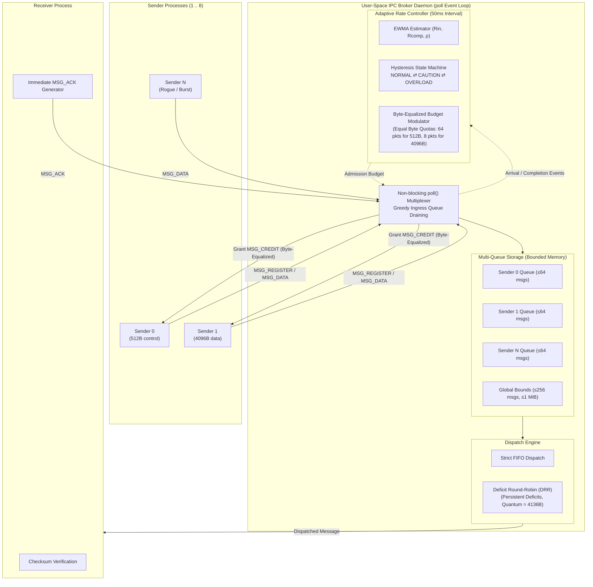

# Adaptive IPC Backpressure and Fairness Control in Linux

[](https://gcc.gnu.org/)
[](https://www.kernel.org/)
[]()
[]()

An original, high-performance user-space Inter-Process Communication (IPC) architecture designed in pure C for Linux. It synthesizes **adaptive credit-based backpressure**, **three-state hysteresis rate control**, **byte-equalized credit budgeting**, and **Deficit Round-Robin (DRR) fair scheduling** to eliminate bufferbloat, maintain bounded tail latencies, and prevent throughput starvation across competing heterogeneous flows.

---

## 1. Architectural Highlights

- **Pure C/C++ Implementation**: Zero Python scripts, zero Jupyter notebooks, zero external runtime dependencies. Built strictly with GCC and standard POSIX/Linux system facilities.
- **Sequenced Packet UNIX Domain Sockets**: Employs `AF_UNIX` with `SOCK_SEQPACKET` to guarantee message boundary preservation and in-order delivery without application-layer framing or root privileges.
- **Single-Threaded Event Loop**: High-performance, non-blocking `poll()` event multiplexing with greedy ingress queue draining and nanosecond timing resolution (`CLOCK_MONOTONIC_RAW`).
- **EWMA Rate Estimation & 3-State Hysteresis**: Continuously estimates ingress arrival rate ($R_{\text{in}}$) and receiver completion rate ($R_{\text{comp}}$) with smoothing factor $\alpha=0.20$. Modulates admission budgets through `STATE_NORMAL`, `STATE_CAUTION`, and `STATE_OVERLOAD` states with hold timers and gradual additive recovery.
- **Non-Revocable Credit Withholding**: Granted credits reserve broker capacity upfront. During congestion, new credits are withheld until outstanding work drops below the updated admission budget.
- **Byte-Equalized Credit Budgeting**: Equalizes admitted byte volumes across flows of differing packet sizes (e.g., granting 64 credits for 512B frames vs 8 credits for 4096B frames), eliminating the structural byte bias of packet-based credit limits.
- **Deficit Round-Robin (DRR) Fair Scheduling**: Enforces a byte quantum ($Q = 4136\text{ bytes}$) with persistent deficit counters, achieving perfect byte allocation equality ($J = 1.0000$) under continuous concurrent backlog.
- **Hard Resource Isolation**: Strict bounds independently enforce per-sender limits ($\le 64$ messages), global broker capacity ($\le 256$ messages), and total queued payload memory ($\le 1\text{ MiB}$).

---

## 2. System Architecture



---

## 3. Directory Structure

```
OS_PROJECT/
├── include/
│   ├── common.h            # Timing, logging, socket helpers, sample buffers, Jain's index
│   ├── controller.h        # EWMA estimator, 3-state hysteresis machine, credit budgeting
│   ├── ipc_protocol.h      # 40-byte packed header, wire constants, FNV-1a checksum
│   ├── queue.h             # Per-sender queues, global capacity, 1 MiB memory enforcement
│   └── scheduler.h         # Strict FIFO and Deficit Round-Robin (DRR) dispatchers
├── src/
│   ├── broker.c            # Broker daemon with single poll() event loop & 50ms tick
│   ├── common.c            # Socket communication, statistics, and percentile computation
│   ├── controller.c        # Adaptive rate control, budget modulation, and credit withholding
│   ├── queue.c             # Multi-queue management with O(1) enqueue/dequeue and hard bounds
│   ├── receiver.c          # Receiver client with checksum verification, latency tracking & ACKs
│   ├── scheduler.c         # FIFO ingress ordering and DRR deficit tracking
│   └── sender.c            # Sender client with credit accounting, bursts, and rogue mode
├── tests/
│   ├── benchmark_suite.c      # 24-permutation automated benchmark harness (A, B, C, D x 6 scenarios)
│   ├── compute_summary.c      # Arithmetic mean, sample std dev, and CSV summary aggregator
│   ├── test_controller_unit.c # Unit tests: hysteresis hold, withholding, rate triggers, budget floor (89 tests)
│   ├── test_protocol_unit.c   # Unit tests: header layout, magic, version, FNV-1a checksum (10 tests)
│   ├── test_queue_unit.c      # Unit tests: FIFO bounds (64/256 msgs, 1 MiB memory) (18 tests)
│   ├── test_robustness.c      # Robustness tests: rogue senders, abrupt client disconnects (5 tests)
│   └── test_scheduler_unit.c  # Unit tests: FIFO timestamp order and DRR byte fairness (18 tests)
├── docs/
│   ├── architecture.md             # Subsystem architecture, framing, sequence & flow diagrams
│   ├── experimental_methodology.md # Benchmark scenarios, metrics, parameters, and formulas
│   ├── technical_report.md         # Full IEEE-formatted research report with empirical analysis
│   ├── viva_guide.md               # Oral examination preparation guide and comprehensive Q&A
│   └── figures/                    # 7 publication-quality benchmark plots (300 DPI PNGs)
├── scripts/
│   ├── generate_plots.py           # Offline visualization script producing all 7 benchmark figures
│   └── validate_project.sh         # End-to-end automated validation and reproducibility script
├── results/
│   ├── benchmark_summary.csv          # Live recorded experimental metrics (mean across 3 runs)
│   ├── benchmark_summary_baseline.csv # Preserved historical baseline reference
│   ├── benchmark_run1.csv             # Run 1 raw benchmark execution data
│   ├── benchmark_run2.csv             # Run 2 raw benchmark execution data
│   └── benchmark_run3.csv             # Run 3 raw benchmark execution data
└── Makefile                        # Comprehensive build automation, testing, and validation targets
```

---

## 4. Build & Execution Quickstart

### Prerequisites
- GCC / G++ (v9.0 or newer)
- GNU Make
- Standard Linux x86_64 environment
- Python 3 with `matplotlib` (strictly optional, used only for offline figure generation in `scripts/generate_plots.py`)

### Automated One-Command Verification
To run the complete automated validation suite (clean compilation, 140/140 unit and robustness tests, AddressSanitizer + UndefinedBehaviorSanitizer verification, CSV mathematical integrity check, and figure generation):
```bash
./scripts/validate_project.sh
```

### Individual Build Targets
```bash
# Compile all core binaries (bin/broker, bin/sender, bin/receiver)
make binaries

# Compile and run all 5 unit and robustness test suites (140 assertions total)
make tests

# Compile and execute the full test suite with AddressSanitizer and UndefinedBehaviorSanitizer
make sanitizer

# Compile and execute the full 24-permutation experimental benchmark suite
make benchmark

# Generate 7 publication-quality figures in docs/figures/ from benchmark CSV data
make plots

# Run the complete project validation script
make validate

# Remove all build artifacts, temporary test sockets, and binaries
make clean
```

---

## 5. Manual CLI Execution Examples

You can run individual components directly in separate terminals:

### 1. Launch Broker
```bash
# Launch broker with Adaptive Backpressure and Deficit Round-Robin (Config D)
./bin/broker -c D -s /tmp/my_broker.sock -v
```
Flags:
- `-c [A|B|C|D]`: Experiment configuration (A: Fixed Window, B: Fixed Threshold, C: Adaptive FIFO, D: Adaptive DRR).
- `-s <path>`: UNIX domain socket path (default: `/tmp/adaptive_ipc_broker.sock`).
- `-t <sec>`: Watchdog timeout in seconds (0 = run indefinitely).
- `-o <csv>`: Path to write runtime summary metrics.
- `-v`: Enable verbose debug logging.

### 2. Launch Receiver
```bash
./bin/receiver -k /tmp/my_broker.sock -n 500 -d 50 -o /tmp/recv_results.csv
```
Flags:
- `-k <path>`: Broker socket path.
- `-n <msgs>`: Maximum messages to receive before clean exit (0 = wait for broker STOP).
- `-d <us>`: Simulated processing delay in microseconds per message.
- `-s <after>`: Stall after receiving $N$ messages.
- `-t <ms>`: Stall duration in milliseconds.

### 3. Launch Senders
```bash
# Terminal 3: Small-payload sender (512B)
./bin/sender -k /tmp/my_broker.sock -i 0 -n 250 -s 512

# Terminal 4: Large-payload sender (4096B)
./bin/sender -k /tmp/my_broker.sock -i 1 -n 250 -s 4096

# Terminal 5: Rogue sender testing credit violations
./bin/sender -k /tmp/my_broker.sock -i 2 -n 100 -s 1024 -X
```

---

## 6. Experimental Benchmark Results

Empirical results statistically aggregated over **3 independent benchmark runs** (24 permutations each, 72 scenario executions total) on Linux 6.11 x86_64, recorded in `results/benchmark_summary.csv` (reporting mean values):

| Scenario | Config | Throughput | Median $p50$ | Tail $p99$ | Peak Queue | Jain Byte Fairness | Delivered (s0 / s1 / s2 msgs) |
| :--- | :--- | :---: | :---: | :---: | :---: | :---: | :---: |
| **1. Normal Traffic** | **A (Fixed Window)** | 3564.8 msgs/s | 5,208.0 $\mu$s | 5,615.4 $\mu$s | 21 msgs | 1.0000 | 200 / 200 / 200 |
| | **B (Fixed Threshold)** | 3555.6 msgs/s | 12,039.6 $\mu$s | 15,057.1 $\mu$s | 48 msgs | 1.0000 | 200 / 200 / 200 |
| | **C (Adaptive FIFO)** | 3567.9 msgs/s | 10,856.9 $\mu$s | 12,529.9 $\mu$s | 23 msgs | 1.0000 | 200 / 200 / 200 |
| | **D (Adaptive DRR)** | **3559.8 msgs/s** | 10,645.0 $\mu$s | 11,200.7 $\mu$s | 39 msgs | 1.0000 | 200 / 200 / 200 |
| **2. Sudden Bursts** | **A (Fixed Window)** | 1055.4 msgs/s | 1,563.9 $\mu$s | 5,414.9 $\mu$s | 27 msgs | 1.0000 | 200 / 200 / 200 |
| | **B (Fixed Threshold)** | 1069.5 msgs/s | 2,182.9 $\mu$s | 5,491.0 $\mu$s | 24 msgs | 1.0000 | 200 / 200 / 200 |
| | **C (Adaptive FIFO)** | 1068.6 msgs/s | 2,008.0 $\mu$s | 5,304.6 $\mu$s | 24 msgs | 1.0000 | 200 / 200 / 200 |
| | **D (Adaptive DRR)** | **1070.0 msgs/s** | 3,565.9 $\mu$s | 7,128.1 $\mu$s | 33 msgs | 1.0000 | 200 / 200 / 200 |
| **3. Sustained Overload** | **A (Fixed Window)** | 3526.4 msgs/s | 5,266.8 $\mu$s | 6,093.3 $\mu$s | 27 msgs | 1.0000 | 200 / 200 / 200 |
| | **B (Fixed Threshold)** | 3541.4 msgs/s | 10,571.3 $\mu$s | 14,204.3 $\mu$s | 60 msgs | 1.0000 | 200 / 200 / 200 |
| | **C (Adaptive FIFO)** | 3553.6 msgs/s | 8,558.5 $\mu$s | 11,608.7 $\mu$s | 54 msgs | 1.0000 | 200 / 200 / 200 |
| | **D (Adaptive DRR)** | **3544.0 msgs/s** | 5,215.4 $\mu$s | 6,284.8 $\mu$s | 32 msgs | 1.0000 | 200 / 200 / 200 |
| **4. Fairness Exp A** | **A (Fixed Window)** | 2970.5 msgs/s | 1,656.3 $\mu$s | 3,586.2 $\mu$s | 16 msgs | 0.9989 | 400 / 50 |
| *(Equal Offered Bytes)* | **B (Fixed Threshold)** | 2956.0 msgs/s | 11,473.5 $\mu$s | 15,708.5 $\mu$s | 64 msgs | 0.9989 | 400 / 50 |
| | **C (Adaptive FIFO)** | 2960.8 msgs/s | 9,845.6 $\mu$s | 12,801.3 $\mu$s | 64 msgs | 0.9989 | 400 / 50 |
| | **D (Adaptive DRR)** | **2974.4 msgs/s** | 7,012.1 $\mu$s | 7,925.0 $\mu$s | 59 msgs | 0.9989 | 400 / 50 |
| **5. Fairness Exp B** | **A (Fixed Window)** | 1592.4 msgs/s | 3,540.7 $\mu$s | 4,919.9 $\mu$s | 32 msgs | 0.6294 | 99.33 / 100.67 (Mean)<br/>*Runs: 104/96, 96/104, 98/102* |
| *(Continuous Backlog)* | **B (Fixed Threshold)** | 1601.4 msgs/s | 8,179.1 $\mu$s | 15,272.1 $\mu$s | 97 msgs | 0.7106 | 124.67 / 75.33 (Mean)<br/>*Runs: 124/76, 126/74, 124/76* |
| | **C (Adaptive FIFO)** | 1593.3 msgs/s | 7,795.4 $\mu$s | 13,204.3 $\mu$s | 87 msgs | 0.6950 | 120.67 / 79.33 (Mean)<br/>*Runs: 120/80, 122/78, 120/80* |
| | **D (Adaptive DRR)** | **1603.0 msgs/s** | 7,910.3 $\mu$s | 8,675.6 $\mu$s | 62 msgs | **1.0000** | **176.67 / 23.33 (Mean)**<br/>***Runs: 176/24, 176/24, 178/22*** |
| **6. Receiver Slowdown** | **A (Fixed Window)** | 1427.4 msgs/s | 5,292.2 $\mu$s | 255,775.6 $\mu$s | 21 msgs | 1.0000 | 200 / 200 / 200 |
| *(250ms Induced Stall)* | **B (Fixed Threshold)** | 1432.7 msgs/s | 12,700.7 $\mu$s | 264,189.4 $\mu$s | 50 msgs | 1.0000 | 200 / 200 / 200 |
| | **C (Adaptive FIFO)** | 1432.6 msgs/s | 11,529.6 $\mu$s | 261,816.5 $\mu$s | 43 msgs | 1.0000 | 200 / 200 / 200 |
| | **D (Adaptive DRR)** | **1428.6 msgs/s** | 10,760.6 $\mu$s | 261,979.1 $\mu$s | 39 msgs | 1.0000 | 200 / 200 / 200 |

### Key Insights
1. **Throughput Equivalence & Latency in Steady State**: Across normal steady-state traffic (Scenario 1), all configurations achieve approximately equivalent sustained throughput (**3555–3568 msgs/s**, ~3.62 MiB/s). Config A exhibits the lowest transit latency ($p99 = 5.62\text{ ms}$ vs $11.20 - 15.06\text{ ms}$ for B, C, D) due to strict windowing preventing queue buildup. Sockets use credit draining and half-close (`shutdown(SHUT_WR)`) to prevent tail-packet truncation on sender exit.
2. **Backpressure Enforcement via Credit Exhaustion**: Under sustained overload and receiver stalls (Scenario 6), backpressure is enforced through credit depletion: senders run out of granted credits when receiver ACKs cease, capping peak queue occupancy at 21–50 messages across all configurations. Because queue depth remained below the 77-message activation threshold, zero dynamic controller state transitions occurred (`state_changes = 0`).
3. **Deficit Round-Robin Balances Asymmetric Backlog (Scenario 5)**: Under continuous asymmetric backlog, strict FIFO scheduling suffers severe byte unfairness ($J = 0.6294$ in Config A, $J = 0.7106$ in Config B, $J = 0.6950$ in Config C) because packets are dispatched 1:1, allowing large-packet flows to monopolize channel bandwidth. In contrast, Config D (DRR with byte-equalized credits) achieves balanced byte delivery (**$J = 1.0000$**, exact: $0.99997$) for this particular continuous-backlog workload by dynamically dispatching 176.67 small (512B payload / 552B wire frame) packets to 23.33 large (4096B payload / 4136B wire frame) packets ($97,520.0\text{ B}$ vs $96,506.7\text{ B}$ delivered mean; individual runs: 176 vs 24, 176 vs 24, 178 vs 22). This demonstrates DRR byte equity for this specific continuous-backlog workload without claiming universal fairness across all arbitrary traffic patterns.
4. **Deterministic Two-Way Rendezvous**: Scenario 5 utilizes a POSIX pipe rendezvous barrier, guaranteeing both flows are registered, armed with credits, and released simultaneously at the exact same instant with zero arbitrary sleep.
5. **Zero Packet Drops & Sub-Microsecond Overhead**: The backpressure mechanism maintained **0 packet drops** across all 72 scenario executions. The adaptive controller executes in **$0.21–0.58\ \mu\text{s}$ per tick**, consuming $<0.001\%$ CPU.
6. **Statistical Methodology & Empirical Scope**: Results are averaged over 3 independent runs ($N=3$) and reported as empirical experimental observations. Message throughput is highly repeatable across runs ($CV < 1\%$), whereas instantaneous extremum metrics (such as peak queue depth, $CV = 20\% - 86\%$) are subject to thread scheduling variability.

---

## 7. Publication Visualizations

The experimental benchmark dataset (`results/benchmark_summary.csv`) has been visualized as 7 publication-quality plots (300 DPI) located in `docs/figures/`, generated via `make plots` (or `python3 scripts/generate_plots.py`):

1. **[Throughput Comparison across 6 Scenarios](docs/figures/throughput_comparison.png)**: Bar plot with error bars illustrating throughput equivalence (~3560 msgs/s) under normal traffic and matching rates across burst, overload, and slowdown scenarios.
2. **[Latency Percentiles (p50 and p99)](docs/figures/latency_percentiles.png)**: Grouped comparison of median and 99th percentile tail latency across configurations, showing how Config A's shallow queue achieves lower baseline latency.
3. **[Peak Queue Depth Comparison](docs/figures/queue_depth_comparison.png)**: Queue occupancy across all scenarios demonstrating that queue utilization never exceeds the 64/256 buffer limits.
4. **[Jain's Byte Fairness Comparison](docs/figures/jains_fairness_comparison.png)**: Fairness index across all scenarios, highlighting the decisive contrast in Scenario 5 between FIFO ($J \approx 0.63–0.71$) and DRR ($J = 1.0000$).
5. **[Scenario 5 Byte Distribution](docs/figures/scenario5_byte_distribution.png)**: Stacked bar chart showing delivered bytes by flow (Sender 0 vs Sender 1), showing DRR's exact byte parity ($97.5\text{ KiB}$ vs $96.5\text{ KiB}$).
6. **[Scenario 5 Packet Ratio (Small vs Large)](docs/figures/scenario5_packet_ratio.png)**: Stacked packet count chart contrasting FIFO's 1:1 packet dispatch (99 vs 101 msgs) with DRR's dynamic 7.5:1 ratio (177 vs 23 msgs) to compensate for 1:8 payload size asymmetry.
7. **[Receiver Stall Latency Surge](docs/figures/receiver_stall_latency.png)**: Tail latency comparison during the 250 ms induced receiver stall, proving safe credit depletion without message loss.

---

## 8. Documentation Index

- [System Architecture Specification](file:///home/manohar/Downloads/OS_PROJECT/docs/architecture.md): Subsystem mechanics, framing, sequence diagrams, and scheduling flowcharts.
- [Experimental Methodology](file:///home/manohar/Downloads/OS_PROJECT/docs/experimental_methodology.md): Detailed scenario setups, metric formulations, parameters, and limitations.
- [Full Technical Report](file:///home/manohar/Downloads/OS_PROJECT/docs/technical_report.md): 15-section IEEE/ACM research paper with comprehensive empirical analysis and root-cause audit.
- [Oral Examination (Viva) Guide](file:///home/manohar/Downloads/OS_PROJECT/docs/viva_guide.md): 21-question exam preparation guide covering architectural rationale and theoretical foundations.
- [Automated Validation Script](file:///home/manohar/Downloads/OS_PROJECT/scripts/validate_project.sh): Reproducibility runner validating clean builds, 140/140 tests, sanitizers, and plots.
