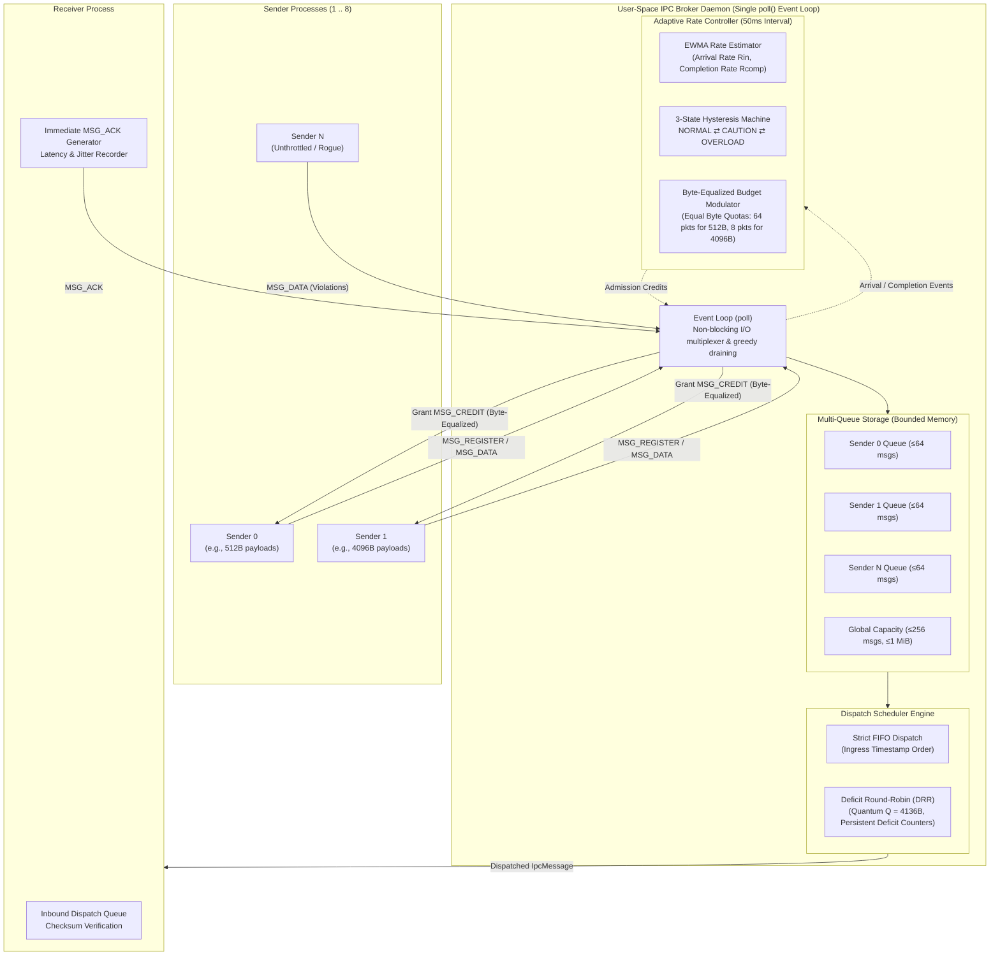
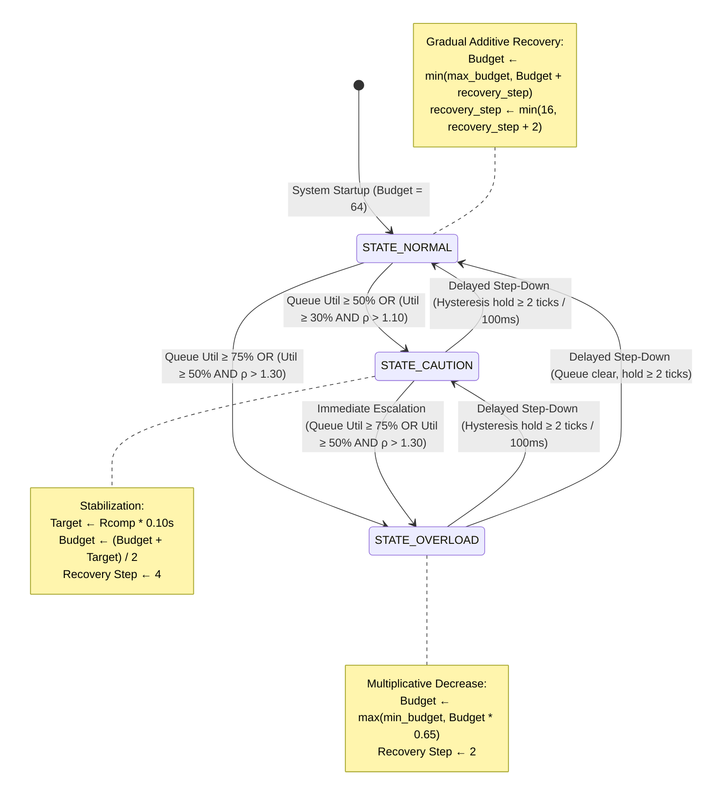

# System Architecture: Adaptive IPC Backpressure and Fairness Control in Linux

## 1. Executive Summary & Design Principles

In high-throughput, multi-producer Operating System environments, Inter-Process Communication (IPC) pipelines frequently suffer from **bufferbloat**, **unbounded queue latency**, and **throughput starvation** when asymmetric senders contend for a shared transmission channel. Conventional IPC mechanisms (such as standard UNIX FIFOs or basic socket buffers) enforce static buffer limits or drop packets blindly, leading to latency collapse during bursty traffic or receiver stalls.

This project implements an original, high-performance, user-space IPC architecture in pure C on Linux. It establishes:
1. **Adaptive Credit-Based Backpressure**: An Exponentially Weighted Moving Average (EWMA) controller monitors arrival rates, receiver completion rates, and queue utilization to dynamically modulate sender admission budgets with hysteresis and gradual recovery.
2. **Byte-Equalized Credit Budgeting**: Sender credit allocations are scaled inversely proportional to packet frame sizes, granting equal byte admission quotas across heterogeneous flows.
3. **Deficit Round-Robin (DRR) Fair Scheduling**: A byte-aware scheduling engine ensures that flows with differing payload sizes (e.g., 512B vs 4096B) receive equitable channel bandwidth, eliminating the 8× throughput bias inherent in standard FIFO dispatch.
4. **Hard Resource Isolation**: Strict bounds independently enforce per-sender limits (≤64 messages), global broker capacity (≤256 messages), and total queued memory (≤1 MiB).
5. **Resilient UNIX Domain Socket Messaging**: Sequenced packet delivery via `AF_UNIX` with `SOCK_SEQPACKET` guarantees message boundary preservation without kernel modifications or root privileges.

---

## 2. System Architecture & Subsystem Diagram

The architecture consists of three distinct process roles communicating asynchronously over UNIX domain sockets:



---

## 3. IPC Binary Wire Protocol Specification

Processes communicate using sequenced packet sockets (`AF_UNIX`, `SOCK_SEQPACKET`). Unlike `SOCK_STREAM` (which requires application-level length prefixes and stream framing) or `SOCK_DGRAM` (which is connectionless and can drop packets), `SOCK_SEQPACKET` preserves discrete message boundaries on every `send()` and `recv()` call, provides guaranteed in-order delivery, and detects peer disconnects reliably.

### 3.1 Protocol Frame Layout (`IpcHeader`)

Every packet transmitted over the wire begins with a fixed 40-byte packed header followed by an optional variable-length payload:

```
 0                   1                   2                   3
 0 1 2 3 4 5 6 7 8 9 0 1 2 3 4 5 6 7 8 9 0 1 2 3 4 5 6 7 8 9 0 1
+-+-+-+-+-+-+-+-+-+-+-+-+-+-+-+-+-+-+-+-+-+-+-+-+-+-+-+-+-+-+-+-+
|                          magic (0x49504350)                   |
+-+-+-+-+-+-+-+-+-+-+-+-+-+-+-+-+-+-+-+-+-+-+-+-+-+-+-+-+-+-+-+-+
|          version (1)          |           msg_type            |
+-+-+-+-+-+-+-+-+-+-+-+-+-+-+-+-+-+-+-+-+-+-+-+-+-+-+-+-+-+-+-+-+
|                           sender_id                           |
+-+-+-+-+-+-+-+-+-+-+-+-+-+-+-+-+-+-+-+-+-+-+-+-+-+-+-+-+-+-+-+-+
|                                                               |
+                       msg_seq (64 bits)                       +
|                                                               |
+-+-+-+-+-+-+-+-+-+-+-+-+-+-+-+-+-+-+-+-+-+-+-+-+-+-+-+-+-+-+-+-+
|                                                               |
+                    timestamp_ns (64 bits)                     +
|                                                               |
+-+-+-+-+-+-+-+-+-+-+-+-+-+-+-+-+-+-+-+-+-+-+-+-+-+-+-+-+-+-+-+-+
|                          payload_len                          |
+-+-+-+-+-+-+-+-+-+-+-+-+-+-+-+-+-+-+-+-+-+-+-+-+-+-+-+-+-+-+-+-+
|                           checksum                            |
+-+-+-+-+-+-+-+-+-+-+-+-+-+-+-+-+-+-+-+-+-+-+-+-+-+-+-+-+-+-+-+-+
|                       payload (0 .. 4096 bytes)               |
|                               ...                             |
+-+-+-+-+-+-+-+-+-+-+-+-+-+-+-+-+-+-+-+-+-+-+-+-+-+-+-+-+-+-+-+-+
```

### 3.2 Message Types
- `MSG_REGISTER` (1): Client announces identity, process role, and typical payload size.
- `MSG_CREDIT` (2): Broker allocates transmission tokens to sender.
- `MSG_DATA` (3): Sender transmits application payload with FNV-1a checksum.
- `MSG_ACK` (4): Receiver notifies broker of message completion, triggering credit return.
- `MSG_STOP` (5): Control signal announcing graceful termination.

---

## 4. Broker Event Loop & Multi-Queue Ingress Draining

The broker runs a single-threaded non-blocking event loop using Linux `poll()`.

### 4.1 Non-Blocking Sockets & Greedy Draining
To eliminate blocking and allow queues to accumulate realistic multi-packet backlogs:
1. Every client socket is switched to non-blocking mode immediately upon `accept()`:
   ```c
   ipc_set_nonblocking(senders[sid].fd, true);
   ```
2. When `POLLIN` is signaled on a sender file descriptor, the broker executes a greedy read loop:
   ```c
   while (qm.queues[sid].count < PER_SENDER_QUEUE_CAP && 
          qm.global_count < GLOBAL_QUEUE_CAP) {
       int r = ipc_recv_msg(senders[sid].fd, &msg);
       if (r == -EAGAIN || r == -EWOULDBLOCK) break;
       // validate and enqueue
   }
   ```
   This prevents head-of-line starvation and ensures competing senders can simultaneously backlog their respective broker queues.

### 4.2 Multi-Queue Storage & Hard Bounds
- **Queue Representation**: Per-sender singly linked FIFO queues with tail pointers for $O(1)$ enqueue and dequeue.
- **Global Accounting**: Thread-safe atomic or single-loop accounting tracks:
  - `PER_SENDER_QUEUE_CAP = 64` messages.
  - `GLOBAL_QUEUE_CAP = 256` messages.
  - `MAX_QUEUED_BYTES = 1,048,576` bytes (1 MiB).
- **Hard Bound Isolation**: If any limit is reached, incoming packets are dropped or rejected before memory is allocated, isolating well-behaved senders from rogue or bursting senders.

---

## 5. Adaptive Backpressure & Rate Control Engine

The adaptive controller operates as an active feedback loop executed every `CONTROLLER_INTERVAL_MS` (50 ms).

### 5.1 EWMA Rate Estimation

During each 50 ms interval $\Delta t$, the broker tracks raw arrival count $A_{\Delta t}$ and receiver completion count $C_{\Delta t}$:
$$\text{Measured Arrival } M_{\text{in}} = \frac{A_{\Delta t}}{\Delta t}, \quad \text{Measured Completion } M_{\text{comp}} = \frac{C_{\Delta t}}{\Delta t}$$

Exponentially smoothed rates are updated using $\alpha = 0.20$:
$$R_{\text{in}}^{(t)} = \alpha M_{\text{in}} + (1 - \alpha) R_{\text{in}}^{(t-1)}$$
$$R_{\text{comp}}^{(t)} = \alpha M_{\text{comp}} + (1 - \alpha) R_{\text{comp}}^{(t-1)}$$

Rate imbalance ratio $\rho$ characterizes channel congestion:
$$\rho = \frac{R_{\text{in}}^{(t)}}{R_{\text{comp}}^{(t)} + 1.0}$$

### 5.2 Three-State Hysteresis State Machine



### 5.3 Non-Revocable Credit Withholding Invariant

A fundamental requirement of credit-based flow control is that **granted credits reserve broker queue capacity upfront**. If congestion forces the controller to reduce the global budget $B_{\text{curr}}$ below currently outstanding credits $W_{\text{out}}$:
1. Outstanding credits are never revoked (senders are not forced to cancel messages in flight).
2. The broker **withholds all new credit grants**:
$$\text{If } W_{\text{out}} \ge B_{\text{curr}} \implies \text{Grant} = 0$$
3. As the receiver completes messages and returns `MSG_ACK`, $W_{\text{out}}$ decrements:
$$W_{\text{out}} \leftarrow W_{\text{out}} - 1$$
4. Once $W_{\text{out}} < B_{\text{curr}}$, credit grants resume proportionally up to the available headroom.

### 5.4 Byte-Equalized Credit Budgeting
In heterogeneous multi-flow environments, allocating equal *packet credits* introduces severe byte discrimination: 32 credits for 4096B payloads grants $132.3\text{ KiB}$ of buffer capacity, whereas 32 credits for 512B payloads grants only $17.6\text{ KiB}$. Under Config D, the broker enforces **byte-equalized credit budgeting**:
$$\text{Credit Limit}_i = \left\lfloor \frac{\text{Byte Quota Target}}{\text{Wire Frame Size}_i} \right\rfloor = \left\lfloor \frac{35,328\text{ bytes}}{\text{Wire Frame Size}_i} \right\rfloor$$
- Sender with 512B payload (552B frame): Granted 64 credits ($35.3\text{ KiB}$).
- Sender with 4096B payload (4136B frame): Granted 8 credits ($33.1\text{ KiB}$).
This equalizes the byte transmission pipeline, enabling DRR to interleave packets at its theoretical $7.49:1$ ratio continuously.

---

## 6. Dispatch Schedulers: Strict FIFO vs Deficit Round-Robin

### 6.1 Strict FIFO Dispatch (`DISPATCH_FIFO`)
- Inspects the head message of all active sender queues using `queue_peek_sender()`.
- Dispatches the message with the strictly oldest ingress timestamp `timestamp_ns`.
- **Limitation**: Suffers from head-of-line blocking and byte-unfairness when large-payload senders (4096B) interleave 1:1 with small-payload senders (512B), allowing the large-payload sender to seize 88% of channel throughput ($J \approx 0.6311$).

### 6.2 Deficit Round-Robin Dispatch (`DISPATCH_DRR`)
- Implements the Shreedhar & Varghese fair queuing algorithm.
- Operates with quantum $Q = \text{MAX\_MSG\_PAYLOAD} + \text{sizeof(IpcHeader)} = 4136\text{ bytes}$.
- Each active sender maintains an accumulated byte deficit counter:
  1. When visiting queue $i$, if $\text{deficit}[i] < \text{head\_packet\_size}$, replenish:
     $$\text{deficit}[i] \leftarrow \text{deficit}[i] + Q$$
  2. While $\text{deficit}[i] \ge \text{head\_packet\_size}$, dequeue and dispatch packet:
     $$\text{deficit}[i] \leftarrow \text{deficit}[i] - \text{packet\_bytes}$$
  3. When $\text{deficit}[i]$ can no longer cover the next packet, advance `current_rr_index = (i + 1) % MAX_SENDERS`.
  4. Deficit counters persist across rounds while the flow remains active. When the queue is drained, deficit counters reset only upon formal flow reinitialization.

### 6.3 Fairness Metric: Jain's Fairness Index

Byte allocation fairness among $n$ active senders transmitting byte volumes $x_1, x_2, \dots, x_n$ is computed as:
$$J(x_1, x_2, \dots, x_n) = \frac{\left( \sum_{i=1}^n x_i \right)^2}{n \sum_{i=1}^n x_i^2}$$
- $J = 1.0$: Perfectly fair allocation.
- $J = \frac{1}{n}$: Completely starved system where 1 flow monopolizes all capacity.

---

## 7. Fault Tolerance, Safety & Teardown

1. **Rogue Sender Protection**: If a malformed or rogue sender submits `MSG_DATA` without credits or exceeds per-sender queue limits, the message is rejected with `QUEUE_ERR_SENDER_FULL` or `QUEUE_ERR_GLOBAL_FULL` and the broker event loop continues operating without disruption.
2. **Abrupt Peer Disconnect**: If a client crashes or terminates abruptly, `recv()` returns 0 or `-ECONNRESET`. The broker cleans up sender state, frees remaining queue nodes, closes the file descriptor, and preserves cumulative dispatch metrics for post-execution auditing.
3. **Graceful Teardown**: Upon receiving `SIGINT` or `SIGTERM`, the broker broadcasts `MSG_STOP` to all clients, drains remaining queues, closes file descriptors, and cleanly unlinks socket files (`unlink(socket_path)`).
