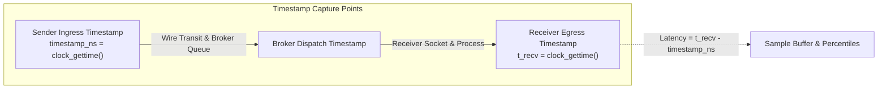

# Experimental Methodology: Adaptive IPC Backpressure and Fairness Control

## 1. Overview of Experimental Goals

The primary research objective of this evaluation is to empirically determine whether **adaptive credit-based backpressure** and **Deficit Round-Robin (DRR) fair scheduling** improve user-space IPC performance, bounded tail latency, and flow fairness under changing and adversarial workloads compared to conventional fixed-window and fixed-threshold mechanisms.

All experiments are conducted on Linux without kernel modifications, specialized hardware, or root privileges, using standard UNIX domain sockets (`AF_UNIX`, `SOCK_SEQPACKET`).

---

## 2. Experimental Configurations

Four distinct configurations are implemented and comparatively evaluated:

| Configuration | Backpressure Controller Policy | Dispatch Scheduler Policy | Rationale |
| :--- | :--- | :--- | :--- |
| **Config A** | **Fixed-Window Baseline** | Strict FIFO | Static per-sender window ($W = 16$ credits). Senders transmit up to their static allocation without rate sensing. Represents conventional socket buffering. |
| **Config B** | **Fixed-Threshold Backpressure** | Strict FIFO | Simple static thresholds: drops budget to $B_{\text{min}} = 8$ when queue utilization $\ge 75\%$; restores budget to $B_{\text{max}} = 128$ when utilization $\le 25\%$. |
| **Config C** | **Adaptive EWMA Backpressure** | Strict FIFO | Full EWMA rate sensing ($R_{\text{in}}, R_{\text{comp}}$), 3-state hysteresis (NORMAL/CAUTION/OVERLOAD), non-revocable credit withholding, and gradual recovery. |
| **Config D** | **Adaptive EWMA Backpressure** | **Deficit Round-Robin (DRR)** | Combines the full adaptive EWMA rate controller with byte-aware DRR scheduling ($Q = 4136\text{ bytes}$) across competing flows. |

---

## 3. Workload Scenarios

The testbed evaluates each of the four configurations across six stress scenarios designed to simulate realistic production and pathological OS communication patterns:

### Scenario 1: Normal Traffic (Symmetric Steady Load)
- **Senders**: 3 concurrent senders, each sending 200 messages (600 messages total).
- **Payload**: Symmetric 1024-byte payloads.
- **Traffic Pattern**: Steady transmission rate, minimal queuing.
- **Objective**: Establish baseline throughput and queuing latency under non-congested conditions.

### Scenario 2: Sudden Bursts (Bursty Traffic with Idle Gaps)
- **Senders**: 3 concurrent senders, each sending 200 messages in 10 bursts of 20 messages each.
- **Payload**: 1024 bytes per message.
- **Gap Interval**: 50 ms idle sleep between consecutive bursts.
- **Objective**: Evaluate how quickly backpressure accommodates sharp arrival surges without buffer overrun, and how gradual recovery prevents secondary shockwaves when the queue drains.

### Scenario 3: Sustained Overload (Ingress Exceeding Capacity)
- **Senders**: 3 concurrent senders transmitting continuously without rate limits or pauses.
- **Payload**: 2048-byte payloads (heavy memory load).
- **Objective**: Verify that hard resource limits (global queue capacity $\le 256$, queued payload $\le 1\text{ MiB}$) prevent memory leaks or process crashes, while credit withholding throttles senders safely.

### Scenario 4: Fairness Exp A (Equal Offered Byte Volume)
- **Senders**: 2 active competing senders with asymmetric packet sizes but identical total offered byte volume:
  - Sender 0: 400 messages $\times$ 512 bytes payload ($204.8\text{ KiB}$ payload, $220.8\text{ KiB}$ wire frame).
  - Sender 1: 50 messages $\times$ 4096 bytes payload ($204.8\text{ KiB}$ payload, $206.8\text{ KiB}$ wire frame).
- **Total Workload**: Receiver processes all 450 messages to completion.
- **Objective**: Evaluate end-to-end fairness when both flows offer equivalent byte volumes, verifying that all configurations deliver high byte fairness ($J \ge 0.95$) over complete symmetric byte transfers.

### Scenario 5: Fairness Exp B (Continuously Backlogged Competing Senders)
- **Senders**: 2 active competing senders continuously backlogged with asymmetric packet sizes:
  - Sender 0: 500 messages $\times$ 512 bytes payload.
  - Sender 1: 250 messages $\times$ 4096 bytes payload (ensures continuous backlog without exhausting offered work during the 200-message measurement window).
- **Evaluation Window**: Evaluated over 200 messages received during an active concurrent backlog.
- **Synchronisation**: Deterministic Two-Way Rendezvous Barrier using POSIX pipes (`ready_pipe` and `sync_pipe`). Both senders register, arm with initial credits, signal readiness to the test harness via `ready_pipe`, and block on `sync_pipe`. The harness reads readiness bytes from both senders and simultaneously releases them by closing `sync_pipe`, guaranteeing true concurrent backlog from the very first packet with 0 arbitrary sleep.
- **Flow Count Declared**: Receiver declared with `-f 2` so a starved sender contributes 0 to the Jain numerator and $n = 2$ to the denominator.
- **Objective**: Expose the fundamental defect of packet-count FIFO scheduling (which yields $J \approx 0.63–0.71$ by alternating packets 1:1), and evaluate whether byte-equalized Deficit Round-Robin (DRR) achieves balanced byte delivery in this specific continuous-backlog workload ($J = 1.0000$, exact: $0.99997$) by dispatching $\approx 7.49$ small packets per 1 large packet.
- **Scope Note**: This demonstrates DRR byte balancing for this specific asymmetric continuous-backlog experiment. It does not constitute a claim of universal fairness across all arbitrary arrival distributions or network topologies.

### Scenario 6: Receiver Slowdown and Recovery (Induced Receiver Stall)
- **Senders**: 3 concurrent senders sending 200 messages each (600 messages total).
- **Fault Injection**: After message #200, the receiver injects an intentional 250 ms processing stall.
- **Backpressure Mechanism**: Senders are restricted by credit allowances ($\le 16$ credits per sender). When the receiver stalls, ACKs cease, causing senders to exhaust credits and block naturally before overloading the broker.
- **Controller Observation**: Because sender credit limits cap total in-flight packets to at most 48 messages, global queue depth remains below the controller's overload threshold ($30\% - 50\%$ of 256 = 77–128 messages). As recorded in live benchmarks, zero state transitions occur (`state_changes = 0`). The measurements demonstrate backpressure via credit exhaustion, not dynamic state machine transitions to `STATE_OVERLOAD`.

---

## 4. Measurement Methodology and Performance Metrics

All metrics are captured online using monotonic nanosecond timers (`CLOCK_MONOTONIC_RAW`) to avoid clock skew or NTP adjustments.

### 4.1 Throughput
- **Message Throughput ($M_{\text{rate}}$)**: Total messages delivered to the receiver divided by total test duration:
$$M_{\text{rate}} = \frac{N_{\text{msgs}}}{\Delta t_{\text{elapsed}}} \quad (\text{messages/second})$$
- **Byte Throughput ($B_{\text{rate}}$)**: Total payload and header volume transferred divided by test duration:
$$B_{\text{rate}} = \frac{V_{\text{bytes}}}{1024 \times 1024 \times \Delta t_{\text{elapsed}}} \quad (\text{MB/second})$$

### 4.2 End-to-End Latency Distribution
The sender writes its raw nanosecond timestamp into the packet header (`header.timestamp_ns`). Upon receipt, the receiver computes elapsed transit latency:
$$L_i = T_{\text{recv}, i} - T_{\text{send}, i}$$
Latencies are accumulated in a dynamically allocated `LatencySampleBuffer`, sorted via `qsort()`, and evaluated for:
- **Median Latency ($p50$)**: Latency at the 50th percentile.
- **Tail Latency ($p95$)**: Latency at the 95th percentile.
- **Worst-Case Tail Latency ($p99$)**: Latency at the 99th percentile, critical for latency-sensitive distributed OS services.
- **Mean Latency ($\mu$)**: Arithmetic average of all delivered messages.

### 4.3 Peak Queue Utilization
- **Peak Message Depth**: The maximum value attained by `qm->global_count` relative to `GLOBAL_QUEUE_CAP = 256`.
- **Peak Queued Payload**: The maximum value attained by `qm->global_queued_bytes` relative to `MAX_QUEUED_BYTES = 1048576` (1 MiB).

### 4.4 Flow Fairness (Jain's Fairness Index)
Calculated across the total volume of bytes processed for **all $n$ declared participating flows**, including any sender that delivered zero bytes:
$$J = \frac{\left( \sum_{i=1}^n B_i \right)^2}{n \sum_{i=1}^n B_i^2}$$
where $B_i$ is the number of bytes delivered for sender $i$, and $n$ is the **declared** flow count (passed to the receiver via `-f n`).

> **Methodological note:** An earlier version of the implementation computed $J$ over only the flows that delivered at least one byte, silently excluding starved senders. This masked starvation (`J = 1.0000` when only 1 of 2 flows delivered data). The corrected implementation always uses $n = $ declared flow count so a 2-flow system where one sender receives nothing correctly yields $J = 0.5000$.

### 4.5 Controller Runtime Overhead
The broker records the exact execution time of every 50 ms controller tick using nanosecond timers:
$$\text{Overhead}_{\text{avg}} = \frac{\sum_{k=1}^K (T_{\text{end}, k} - T_{\text{start}, k})}{K} \quad (\mu\text{s/tick})$$
Proves that adaptive state calculations do not degrade IPC forwarding rates.

### 4.6 Byte Accounting and Wire Frame Sizing
Byte accounting throughout the system uniformly measures complete DATA wire frames:
$$\text{frame\_size} = \text{sizeof}(IpcHeader)\ [40\text{ bytes}] + \text{payload\_len}$$
- Small message (512B payload): $40 + 512 = 552$ bytes.
- Large message (4096B payload): $40 + 4096 = 4136$ bytes.
- Standard message (1024B payload): $40 + 1024 = 1064$ bytes.
- Overload message (2048B payload): $40 + 2048 = 2088$ bytes.

In every individual run without exception, delivered bytes strictly satisfy:
$$\text{total\_bytes}_i = \text{message\_count}_i \times \text{frame\_size}_i$$
Control frames (`MSG_CREDIT`, `MSG_ACK`, `MSG_STOP`) are exchanged between endpoints and the broker for flow control and are never counted towards receiver data volume.

In multi-run aggregate reports (such as `results/benchmark_summary.csv`), the reported message and byte counts represent the arithmetic mean across 3 independent runs. Fractional message counts (e.g., $99.33$ and $176.67$) arise naturally from averaging integer run counts ($104, 96, 98 \to 99.33$ and $176, 176, 178 \to 176.67$). Multiplying mean message count by frame size yields the exact mean byte volume ($99.333333 \times 552 = 54,832.0\text{ B}$; $176.666667 \times 552 = 97,520.0\text{ B}$). Jain's fairness index for aggregate configurations is computed directly from the recorded mean delivered byte volumes:
$$J = \frac{\left( \sum_{i=1}^n \bar{B}_i \right)^2}{n \sum_{i=1}^n \bar{B}_i^2}$$

### 4.7 Exact Benchmark Metric Definitions
All reported benchmark metrics correspond to precise, verified source code accounting:

| Metric | Source Code Location | Description & Units |
| :--- | :--- | :--- |
| `throughput_msgs_per_s` | `src/receiver.c` L169 | Delivered messages per second ($N_{\text{msgs}} / \Delta t$). |
| `throughput_mib_per_s` | `src/receiver.c` L170 | Delivered wire-frame bytes per second ($V_{\text{bytes}} / (1024 \times 1024 \times \Delta t)$), including the 40-byte IPC header (`sizeof(IpcHeader)` + `payload_len`). Note: This is wire-frame throughput, not payload-only throughput. |
| `peak_queue_msgs` | `src/queue.c` L79-81 | Maximum number of messages simultaneously held in the broker queue (`qm->peak_count`). |
| `peak_memory_kib` | `src/queue.c` L82-84 | Maximum queued payload memory in KiB (`qm->peak_bytes / 1024.0`), excluding IPC headers and queue-node heap overhead. |
| `p50_us`, `p95_us`, `p99_us` | `src/receiver.c` L120-123 | Sender-to-receiver transit latency measurements in microseconds ($\mu$s), captured via monotonic raw timestamps from transmission to arrival. |
| `jain_fairness` | `src/common.c` L47-60 | Jain's fairness index computed over all $n$ declared flows (using `-f n`) using their delivered wire byte counts ($B_i$). Any non-transmitting declared flow contributes $0\text{ bytes}$. |
| `ctrl_overhead_us` | `src/controller.c` L109, L206 | Microseconds spent inside `controller_tick()` evaluating rate EWMAs, traffic intensity $\rho$, and state hysteresis per tick, excluding socket I/O, framing, credit generation, and broker dispatching. |

### 4.8 Statistical Methodology and Limitations
1. **Sample Size**: All reported benchmark results are derived from **three independent runs ($N=3$)** per permutation.
2. **Reporting Format**: Metrics are reported as sample means with sample standard deviations ($\bar{x} \pm s$).
3. **Empirical Nature**: Findings are reported as observed experimental results under controlled Linux user-space conditions, not formal proofs of asymptotic statistical significance.
4. **Variability in Extremum Metrics**: While message throughput demonstrates high repeatability ($CV < 1\%$), extreme-value supremum metrics (such as `peak_queue_msgs` and `peak_memory_kib`) exhibit sample variability ($CV = 20\% - 86\%$) due to OS scheduling interleaves. Differences in peak queue depth between configurations must therefore be interpreted as empirical observations rather than guaranteed mathematical bounds.

---

## 5. Experimental Testbed Environment

- **Operating System**: Linux 6.11 (x86_64, Ubuntu 24.04 LTS).
- **Compiler**: GCC 13.3.0 with `-Wall -Wextra -O2 -g`.
- **IPC Fabric**: `AF_UNIX`, `SOCK_SEQPACKET`.
- **Hardware Isolation**: Non-destructive user-space process group execution; standard process priority; no root privileges.
